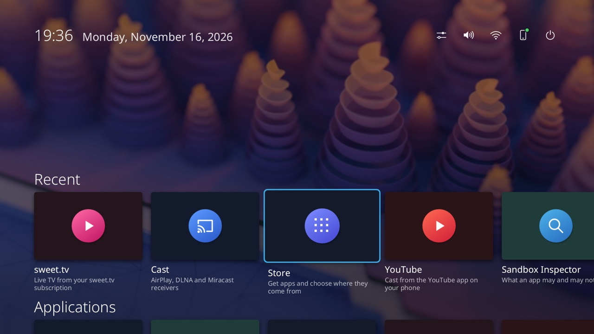
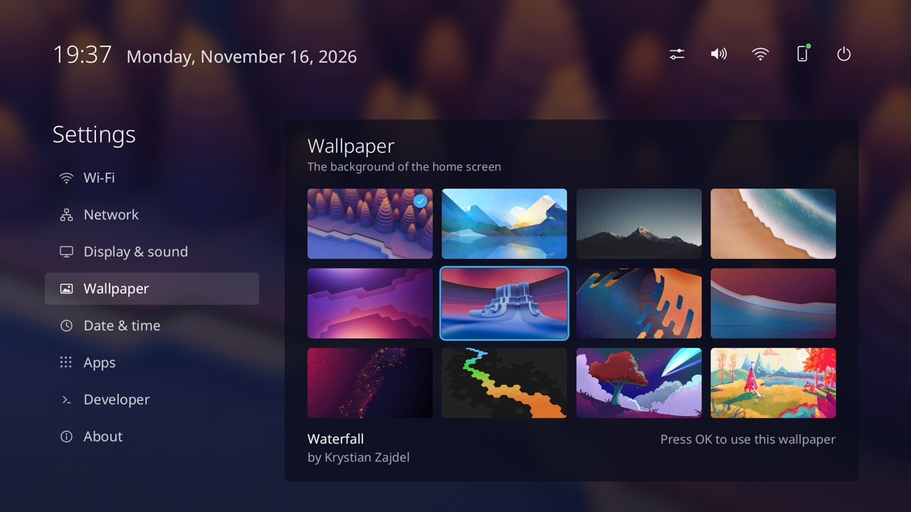
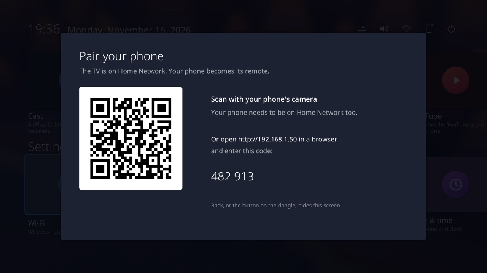
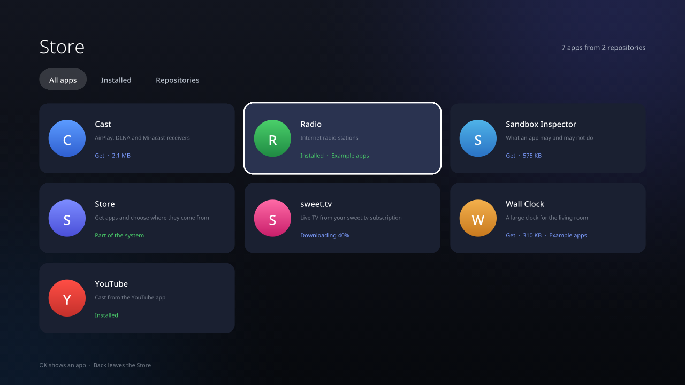

# meowcast

Open firmware for cheap HDMI "cast" dongles: a small Linux system with a TV launcher, sandboxed
apps and a phone remote, replacing the stock firmware of the stick.



| | | |
| --- | --- | --- |
|  |  |  |

More screens (settings, permissions, the Store) are in the [showcase](docs/SHOWCASE.md).

It boots in a few seconds from 16 MiB of flash, runs in 256 MiB of RAM, draws its interface
with the GPU at 60 fps, and loads its apps over the network into RAM. You build it yourself,
flash it yourself, and run the small cloud side (app store, phone relay) on your own
Cloudflare account.

> **Status: early.** It runs on one board, developed on one unit. Flashing can brick a device
> if the steps are not followed; the tools keep a way back to the stock firmware, and you
> should read the board's page before writing anything.

## What is in it

| | |
| --- | --- |
| **Launcher** (`ui/`) | A GLES2 renderer written for this hardware: home screen, settings, wallpapers, boot intro. Rust |
| **Apps** (`apps/`) | `appd` runs each app in its own sandbox (namespaces, cgroups, Landlock, seccomp) with a permission system, and installs signed apps from a store or from repositories you add. An SDK for writing your own |
| **Included apps** | The Store app, an example app, and system services for network and image decoding |
| **More apps** | Casting receivers (AirPlay, DLNA, Miracast), a YouTube cast receiver and an IPTV client live in their own repository, [meowcast/apps-extra](https://github.com/meowcast/apps-extra). A device gets them by adding that repository's address in the Store |
| **Phone remote** (`cloud/pilot`, `cloud/relay`) | A web app paired by QR code. It reaches the device through a relay, so it works when the router isolates Wi-Fi clients |
| **Network** (`apps/netd`, `wifi/`) | Wi-Fi setup from the phone (captive portal), time sync, a paired developer bridge (SSH over the relay) |
| **OS image** (`os/`) | Linux 7.3 kernel with everything in an initramfs: BusyBox, Mesa/Lima, thermal and button daemons |
| **Boards** (`boards/`) | Device trees, boot code, flash layout and flashing tools per device |

## Supported hardware

| Board | SoC | RAM / flash | Status |
| --- | --- | --- | --- |
| [`rk3228a-dongle`](boards/rk3228a-dongle/README.md) | Rockchip RK3228A | 256 MiB / 16 MiB SPI NOR | Works: display to 4K30, GPU, hardware video decoding, HDMI audio, Wi-Fi, flash boot |

Other devices need a port: [boards/README.md](boards/README.md) says what a board directory
contains and what the rest of the tree expects from it.

## Quick start

You need Docker, Python 3, Node.js 20 or newer, git and about 12 GB of disk. The build was
developed on macOS (Apple silicon) and its builder image also exists for x86-64 Linux.

```sh
git clone https://github.com/meowcast/meowcast && cd meowcast
./meow setup          # config.env from the example, builder images
./meow fetch          # pinned sources, crates, Wi-Fi driver, board tools
./meow cloud deploy   # optional: your own store, relay and phone remote on Cloudflare
./meow build          # the firmware image for BOARD (default rk3228a-dongle)
```

Then follow the board's page to try it from RAM (nothing is written to the device) and to
flash it: [boards/rk3228a-dongle/README.md](boards/rk3228a-dongle/README.md).

Without `./meow cloud deploy` the firmware still builds and runs; it then has no app store and
the phone remote only works on networks where the phone can reach the device directly.

## Documentation

- [Showcase](docs/SHOWCASE.md): what it looks like
- [Building](docs/BUILDING.md): the build steps, what each produces, tests
- [Configuration](docs/CONFIGURATION.md): every `config.env` value
- [Your cloud side](docs/CLOUD.md): deploying the store, relay and phone remote
- [Architecture](docs/ARCHITECTURE.md): how the parts fit together and who trusts whom
- [Porting to a new board](boards/README.md)
- [Writing an app](apps/README.md) and [running your own app repository](cloud/store/README.md#a-repository-of-your-own)
- Component documentation: [os](os/README.md), [ui](ui/README.md), [apps](apps/README.md),
  [wifi](wifi/README.md), [cloud](cloud/README.md), [tools](tools/meowdbg.py)

Much of the component documentation is an engineering log: it records what was measured on
the first board and when. Dates in it are 2026.

## Design credits

The launcher's look follows [Plasma Bigscreen](https://plasma-bigscreen.org/), KDE's
interface for TVs: the rows of cards, the top bar and the settings layout are modelled on
it. The code is written from scratch for this hardware and shares none with it. The
wallpapers are a selection of [KDE Plasma's wallpapers](https://github.com/KDE/plasma-workspace-wallpapers),
used under their licences with their authors credited on the device and in
[CREDITS.txt](cloud/store/www/assets/wallpapers/CREDITS.txt). meowcast is not a KDE project.

## Contributing

Patches, ports and bug reports are welcome: see [CONTRIBUTING.md](CONTRIBUTING.md). Security
problems go through [SECURITY.md](SECURITY.md), not the public tracker.

## Licence

GPL-3.0-or-later, see [LICENSE](LICENSE), with two exceptions:

- The libraries an app links, [`apps/sdk`](apps/sdk) and [`apps/media`](apps/media), and the
  example app are **MIT OR Apache-2.0**, so your own app can carry any licence.
- Kernel-side files carry their own SPDX identifiers (GPL-2.0, or GPL-2.0+/MIT for device trees).
 Third-party material and its licences are listed in
[THIRD-PARTY.md](THIRD-PARTY.md).

meowcast is not affiliated with Rockchip or with any company whose devices or services an app
talks to.
Product names are used to say what the software works with.
