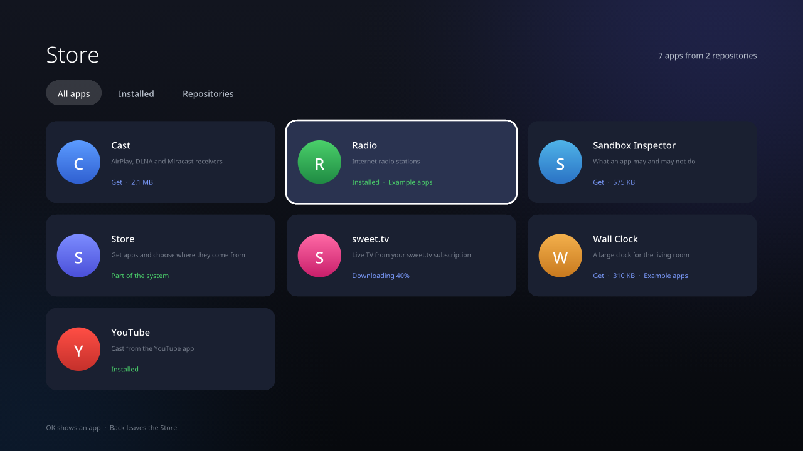

# meow apps: app manager, permission system and SDK

*meow* is the codename (and boot wordmark) of this custom firmware.

Apps for the RK3228A dongle are written in Rust and fetched from an app store into RAM. Only
small records live on the 16 MiB flash. This directory holds:

- the app manager (`appd`);
- the network service (`meow-net`): TLS, certificates and HTTP for every app;
- the image service (`meow-image`): WebP and JPEG decoding for every app, loaded from the
  store when first needed;
- the Store app (`dev.meow.store`): where the user gets apps and chooses the repositories
  they come from ([below](#the-store-app-and-repositories));
- the app SDK (`meow-app`);
- an example app (`Sandbox Inspector`);
- the development store.

The launcher side lives in [../ui/src/apps.rs](../ui/src/apps.rs).

Everything below runs on the first board. The store is a static site
(<https://store.example.org> stands for yours, [../cloud/store](../cloud/store/README.md)) reached
over HTTPS.

## The pieces

```text
 Cloudflare (server/www)                 dongle
 ┌─────────────────────────┐ Wi-Fi or ┌──────────────────────────────────────────────────┐
 │ meowcast-store     │ USB link │ appd (root)                                      │
 │  www/index.json         │◄─────────┤  store client: signature + hash checks           │
 │  www/apps/<id>/<code>/  │  HTTPS   │  installs: /data/appd (flash), payloads: /apps   │
 │   manifest.json  (signed)│          │  launches sandboxes, brokers capabilities        │
 │   manifest.sig           │          │      ▲ /run/appd/ui.sock          ▲ fd 3 broker  │
 │   payload.tar            │          │      │                            │              │
 │ build-apps.sh (signs)   │          │ miracast-ui (launcher)      app (uid 10000+, own  │
 └─────────────────────────┘          │  cards, consent dialog,      namespaces, cgroup,  │
                                      │  hands over the screen       Landlock, seccomp)   │
                                      └──────────────────────────────────────────────────┘
```

| Piece | What it is | Where |
| --- | --- | --- |
| `appd daemon` | Root app manager, started at boot by `appd-session`. One poll loop, with downloads on worker threads | [appd/src/daemon.rs](appd/src/daemon.rs) |
| `appd sandbox-exec` | Builds one app's sandbox. A separate single-threaded process that appd spawns; it never forks a multi-threaded process | [appd/src/sandbox.rs](appd/src/sandbox.rs) |
| `appctl` | Command-line control (a symlink to appd) | [appd/src/ctl.rs](appd/src/ctl.rs) |
| `appd keygen/pack/index/verify/assets` | Publishing tools, built for the build host | [appd/src/tools.rs](appd/src/tools.rs) |
| `appd store-check` | Fetches a live store with the device's client code and checks everything | [appd/src/tools.rs](appd/src/tools.rs) |
| HTTP client | GET over http:// or https:// (through `meow-tls`), keep-alive, chunked | [appd/src/http.rs](appd/src/http.rs) |
| `meow-app` | SDK: broker connection, keys, storage sync, background-service calls, the volume pop-up (`osd` feature) and a brokered GLES2 display (`display` feature) | [sdk/src](sdk/src) |
| Sandbox Inspector | Example app: probes its own sandbox and shows the results | [examples/inspector](examples/inspector) |
| `meow-net` | The network service: a sandboxed system service from the store that makes every app's HTTP(S) requests ([below](#the-network-service)) | [netsvc/src](netsvc/src) |
| `meow_app::net` | The app side of it: `Client::get/request/get_range/open_stream` | [sdk/src/net.rs](sdk/src/net.rs) |
| `meow-image` | The image service: a sandboxed system service from the store that decodes WebP and JPEG pictures for apps, fetched when one is first needed ([below](#the-image-service)) | [imagesvc/src](imagesvc/src) |
| `meow_app::image` | The app side of it: `Decoder::decode(bytes, fit)`. `meow_media::image` adds PNG and picks by the file's first bytes | [sdk/src/image.rs](sdk/src/image.rs), [media/src/image.rs](media/src/image.rs) |
| Cast, YouTube, sweet.tv | Casting receivers and service clients. Not in this tree: they are built from [meowcast/apps-extra](https://github.com/meowcast/apps-extra) and reach a device as an added repository. This document still uses them as examples of what the platform does | [apps-extra](https://github.com/meowcast/apps-extra) |
| Store | The device's app store: every app of every repository, install, open, uninstall, and the list of repositories ([below](#the-store-app-and-repositories)) | [store](store/README.md) |
| Repositories | The built-in meow store plus the ones the user adds by address, each with its own pinned signing key | [appd/src/repos.rs](appd/src/repos.rs) |
| Launcher integration | Cards of the installed apps, Enter to launch, consent dialog for an update's new permissions, screen handover, key forwarding | [../ui/src/apps.rs](../ui/src/apps.rs), `home.rs`, `main.rs` |

## App lifecycle

1. **Discover.** appd fetches `index.json` from the store, and then from every repository the
   user added. It retries every 5 s until the first success (at boot it starts before the
   network), then refreshes every 15 min.
   - Each manifest of the store is checked against the trusted keys in `/etc/appd/keys`, which
     is part of the read-only initramfs; each manifest of an added repository against the
     one key pinned when it was added.
   - A manifest that fails the check is dropped and logged.
   - The launcher lists the **installed** apps (installed, downloading, running or error).
     Everything else there is to get is listed in the Store app, which appd installs by
     itself.
2. **Install (in the Store app).** The app's page lists what it asks for; **Install** shows a
   question when some of it is sensitive, and the Store sends the answer to appd.
   - **Allow** grants every requested permission.
   - **Don't allow** grants only the normal ones and records the sensitive ones as denied.
     If a denied sensitive permission is `required`, the install is cancelled.
   - appd then writes the signed manifest and the grants to flash.
3. **Fetch.** The payload is downloaded into the RAM tmpfs `/apps/<id>` (64 MiB, root only),
   checked against the size and SHA-256 in the signed manifest, and extracted by a strict
   ustar reader. That reader accepts plain files and directories only, so no links and no
   `..`. The payload stays in RAM until reboot; nothing executable is ever stored on flash.
4. **Launch.** For an app with "display":
   1. appd asks the launcher to release the screen (`RELEASE_DISPLAY`).
   2. The launcher drops DRM master.
   3. appd opens the KMS card; its open file becomes the master.
   4. appd spawns the sandbox. The app gets that same open file over its broker socket.
5. **Run.**
   - The launcher forwards keys to the app. The **Home** key always goes to the system.
   - `/data` is a quota-sized tmpfs. On request (`SYNC`, rate-limited to one per 10 s) appd
     saves it to flash, and only if the content changed.
6. **Leave (Home, Back in the app, or a crash).**
   1. appd revokes the screen by dropping master on its own copy, so the app's KMS calls fail
      from then on.
   2. The launcher takes master back and does a full redraw. The mode is unchanged, so the TV
      doesn't re-sync.
   3. The app gets `QUIT`. After 3 s appd writes `cgroup.kill`.
   4. Its `/data` is saved to flash and unmounted, and the cgroup is removed.
7. **Update.** When the store has a higher `version_code`, appd updates the installed record,
   and the next launch fetches the new payload.
   - A new *optional* sensitive permission does not hold the update back. It stays undecided
     (not granted), and the next time the user opens the app the launcher asks
     ("YouTube was updated. The new version would also like to: …", Allow / Don't allow),
     then opens the app either way. Settings > Apps shows and changes the answer.
   - A new *required* sensitive permission does: appd keeps the old version and reports
     "update N needs approval".
8. **Recent.** Every app the user opens moves to the front of the recents list (8 entries,
   `/data/appd/recents`, written only when the order changes). The launcher's Recent row is
   that list (`RECENTS id …` on the control socket, `appctl recents`); uninstalling an app
   takes it off.

## The Store app and repositories



**Repositories.** A repository is a static file tree that lists signed apps
([../cloud/store/README.md](../cloud/store/README.md) says how to make one).

| | The meow store (built in) | A repository the user adds |
| --- | --- | --- |
| Address | From the firmware (`/etc/appd/store.conf`); the Cloudflare store today | Typed in the Store app, or `appctl repo add URL`. `https://` only, except private addresses (a store on the desk) |
| Signing key | The keys in `/etc/appd/keys` (read-only initramfs) | The one key its `repo.json` names when it is added. The user sees its fingerprint and confirms; it is then pinned in `/data/appd/repos.json` |
| May carry | Apps, system services, the signed asset index, apps with `manage-apps` | Apps. A manifest with `service` or `manage-apps` is dropped and logged |
| App ids | Win: nothing takes an id away from it | An id belongs to the first repository that lists it. An installed app is only updated from the repository it was installed from |
| Can be switched off or removed | No | Yes. Off: its apps are not offered and installed ones get no updates, but keep working. Removed: the apps installed from it go too, with their data |
| Install | The Store app asks about sensitive permissions | The same question; nothing about a repository skips it |

- The key is pinned, so the repository's host or the network can withhold apps but cannot
  publish under a repository the user added: a manifest signed with another key is dropped,
  whatever `repo.json` says later.
- An installed app records its repository (`source.json`). At start its manifest must verify
  with that repository's key; if the repository is no longer on the device, the record is
  not loaded.
- At most 8 added repositories, 256 apps each. They are fetched after the meow store, each
  on its own connection; one that fails does not hold the others back.

**The Store app** (`dev.meow.store`, crate [store](store/README.md)) is an ordinary sandboxed
app with three permissions: `display`, `input` and `manage-apps`. It has no network access
and installs nothing itself: appd fetches, verifies and installs, and the app asks it over
the broker (`STORE …`, [Protocols](#protocols)). What the app adds is the screens.

| Concern | How it is handled |
| --- | --- |
| How it gets on the device | appd installs an app of the built-in repository that asks for `manage-apps` as soon as the store lists it, with everything granted, as it does for the system services. The firmware trusts the key that signed it for everything else already |
| Who may hold `manage-apps` | Only an app of the built-in repository. appd drops such a manifest from any other repository, and checks the repository again on every request |
| Uninstalling it | Refused ("part of the system"), in the Store and with `appctl` |
| The permission question | Drawn by the Store app, which has the screen. appd takes its answer (`install id allow\|deny`) as it took the launcher's before. "Don't allow" installs without the sensitive permissions, or cancels when one of them is required |
| After an install | appd fetches the payload at once (payloads live in RAM), so **Open** does not wait for it |
| Open | The Store asks appd; appd closes the Store, the launcher takes the screen back and the app starts the usual way, with the launch transition |
| Adding a repository | The address is typed on an on-screen keyboard or on the phone remote. appd looks it up (`repo.json` and the index, nothing is stored), the Store shows name, key fingerprint and number of apps, and only the fingerprint that was shown can be added |
| Offline | The lists come from appd's memory: installed apps are always there, the rest once the repositories were reached. A repository that cannot be reached says so on its row |

Checked on the build host on 15 Nov 2026 with `sh test-store.sh` (the real appd in the builder
container against three local repositories, and a screenless build of the Store app talking
to it from its sandbox): 45 checks, among them the pinned key (an update signed with another
key is refused), the id rule, the refused service and `manage-apps` manifests, restart,
switching off, removal with the installed apps, and every Store request.

On the dongle, 15 Nov (RAM boot of this firmware, a RAM copy of `/data`, the store served from
the Mac over the USB link, keys sent with `appctl key`, the screen read back with the app's
`shot` key):

| What | Result |
| --- | --- |
| First refresh | appd installed the Store by itself; the launcher got the installed apps only |
| A key press | Drawn in 36–42 ms (the list) or 30–54 ms (other screens), on screen 80–130 ms after the key, with the CPU at 600 MHz. Before two changes it was 85 ms and 150 ms: glyphs are now drawn once and kept, and panels are filled a row at a time |
| Memory | 42 MiB of its 64 (the canvas, its copy, the kept background and the two screen buffers) |
| Adding a repository | An address typed as the phone remote types (`text:` keys); looked up, name, key fingerprint and app count shown, added on **Add**, its app listed a moment later |
| Installing its app | The question showed the optional `network` permission; **Allow** installed it, `source.json` names the repository, the payload was fetched at once |
| Open | The Store closed, the launcher played the launch transition (20 frames, none late), the app ran in its sandbox and returned to the launcher on Home |
| Uninstall, then removing the repository | Both done from the screens; `repos.json` empty again |
| The other apps under this appd and SDK | sweet.tv played live TV, the inspector passed its probes, the YouTube and Cast services restarted on their new builds |

## Permissions

An app declares permissions in its manifest. An unknown permission makes the install fail,
so an app can never run with less isolation than it expects.

| Permission | Level | With it | Without it |
| --- | --- | --- | --- |
| `display` | normal | While in front: the DRM master file is brokered to the app, `/dev/dri/renderD128` (owned by the app's uid) and a read-only `/sys` are mounted | No GPU, no screen |
| `media` | normal | The hardware video decoder (`/dev/video*`, `/dev/media*`) and the HDMI sound card's playback stream (`/dev/snd/pcmC*D*p`) appear in `/dev`, owned by the app's uid. Needs a `MEDIA=1` firmware build | No decoder, no sound |
| `input` | normal | While in front: keys arrive on the broker as `KEY up` etc. | No keys |
| `storage` (`quota_kb` 1–1024) | normal up to 256 KiB, sensitive above | Private `/data` (tmpfs of exactly the quota, `noexec`), loaded from and saved to the flash data partition | `/data` is an empty read-only directory and `HOME=/tmp` |
| `internet` (`hosts`: 1–16, or `"*"` alone) | **sensitive** | HTTP(S) to the listed hosts through the [network service](#the-network-service). The app's own network namespace stays empty (unless it also has `lan` or `network`). `["*"]`, as the whole list, is any public host: for an app that plays whatever address it is handed ([Cast](https://github.com/meowcast/apps-extra/blob/main/cast/README.md)); the dialog then says "Connect to any site on the internet", and the home network stays out of reach as for every list | No way out |
| `network` | **sensitive** | The device's network namespace: raw sockets, the internet and the home network. For apps that need more than HTTP(S) (discovery, UDP) | Its own empty network namespace (loopback only), plus Landlock forbids TCP connect/bind |
| `lan` (`ports`: up to 16 TCP and 16 UDP) | **sensitive** | The device's network namespace, for apps that talk to devices at home: listening sockets, multicast discovery (SSDP, mDNS), UDP streams. The app can bind only the fixed ports its manifest lists, and ports the kernel picks; where it connects and sends is **not** confined ([below](#what-lan-confines)). Used by [Cast](https://github.com/meowcast/apps-extra/blob/main/cast/README.md) | As without `network` |
| `manage-receivers` (with a `manages` list) | **sensitive** | The app may read and set the "Run in background" switch of the apps its signed manifest lists under `manages` ([below](#one-app-switching-anothers-background-service)) | Such requests are answered `denied` |
| `wifi-direct` | **sensitive** | May ask the system to be a Miracast sink: `MIRACAST on pbc\|pin NAME`, `disconnect`, `off` on the broker; the state comes back as `MIRACAST off \| starting \| ready \| pin N \| connecting [who] \| peer ip:port \| unavailable why`. meow-netd does the Wi-Fi Direct work ([../wifi/README.md](../wifi/README.md#miracast-wi-fi-direct)); the app never touches the radio. One app holds the receiver at a time, and it stays up for 20 s while that app's service hands over to the app ([appd/src/miracast.rs](appd/src/miracast.rs)). Untested on hardware. Used by [Cast](https://github.com/meowcast/apps-extra/blob/main/cast/README.md) | The request is answered `unavailable` |
| `manage-apps` | **sensitive**, built-in repository only | The app is the device's app store: it sees every app of every repository, installs, uninstalls and opens apps, and changes the list of repositories, all through the broker ([below](#the-store-app-and-repositories)). appd installs such an app itself and refuses to uninstall it | `STORE` requests are answered with an error |
| `background` (with a `background` section) | **sensitive** | A small second instance of the app runs while the app is closed, and may ask for the app to be opened ([below](#background-services)) | The app runs only while it is open |

An app that only talks to web services asks for `internet`, not `network`. The consent dialog
then names the sites ("Connect to youtube.com, googlevideo.com", or "any site on the
internet" for `"*"`), and an update that swaps a
granted `network` for `internet` is installed without asking again, because it asks for less.

Policy is in [appd/src/perms.rs](appd/src/perms.rs).
- `appctl grant|revoke ID PERM` changes a decision; it takes effect at the next start
  (`background` at once: the service starts or stops).
- Settings > Apps lists every installed app with its permissions (level, the manifest's
  reason, the hosts, the quota, allowed or not) and its "Run in background" switch.
- Required permissions can't be revoked (uninstall instead).
- appd refuses an install whose storage quota no longer fits in `/data`, after keeping a
  768 KiB reserve for its own records and JFFS2 garbage collection.

### What `lan` confines

`lan` is for receivers and controllers on the home network. What the kernel of this
firmware can enforce per app, and what it cannot:

| | With `lan` | How |
| --- | --- | --- |
| Binding a fixed TCP or UDP port | Only the ports in the manifest (`"ports": {"tcp": [7000], "udp": [5353]}`, each 1024 or higher); anything else fails with `EACCES` | Landlock port rules (TCP since ABI 4, UDP since ABI 10; this kernel has ABI 11) |
| Binding port 0 (the kernel picks one from the ephemeral range) | Allowed | A Landlock rule for port 0 |
| Ports below 1024 | Refused, as for every app | No capabilities |
| Raw IP, packet sockets | Refused, as for every app | No capabilities, and seccomp refuses the socket families |
| Netlink | Only the routing protocol (interface and address lists, read-only without capabilities). Socket diagnostics, which would list every connection on the device, and the other protocols are refused, for every app | seccomp on `socket` |
| Connecting (TCP) and sending (UDP) | **Not confined:** any address, at home or on the internet, any port | See below |
| Accepting connections | **Not confined** by source address. The Cast app's DLNA server itself only answers private and link-local peers; AirPlay answers anyone who can reach the port | |
| Seeing the network | Interfaces, addresses, routes and the neighbour table (the MAC addresses of devices at home), as any process in the namespace | |

So `lan` is weaker than its label in one way that matters: an app that holds it can reach
the internet directly. The consent text ("Find and talk to devices on your home network")
says what the app is for, not a limit the system enforces. What would be needed to confine
destinations to private ranges, none of which this kernel has:

- Landlock restricts ports, not addresses. Port rules for connecting and sending exist, but
  the ports of devices at home are not known in advance (a DLNA server's media port, the
  timing port an AirPlay sender chooses), so they are left open rather than listed.
- seccomp sees a syscall's numbers, not the address a pointer leads to.
- A cgroup socket-address filter needs `CONFIG_BPF_SYSCALL` and `CONFIG_CGROUP_BPF`; a
  packet filter needs netfilter; routing by uid (a rule that sends an app's uid to a table
  with only the private ranges) needs `CONFIG_IP_ADVANCED_ROUTER` and
  `CONFIG_IP_MULTIPLE_TABLES`. All are off in this kernel (checked in the build's `.config`;
  IPv6 is off too).
  The uid routing rule is the cheapest of the three: two config options and a handful of
  netlink messages from appd per `lan` app, with no change to the apps.

The background instance of a `lan` app runs under the same rules.

## The network service

Apps do not ship TLS, root certificates or HTTP code. One sandboxed process does that work for
all of them, so there is one place to fix a networking bug and one trust policy to update.

```text
 app (uid 10001, empty network namespace)            meow-net (uid 10002, device network)
 ┌──────────────────────────────┐  dial (fd 4)       ┌───────────────────────────────────┐
 │ meow_app::net::Client        │── OPEN n ─────────►│ one thread per channel:           │
 │   get / request / get_range  │◄─ OK n + channel ──│  host list of the app's manifest  │
 │   open_stream (long polls)   │                    │  public addresses only            │──► TCP / TLS
 │                              │◄═ request/response═►│  rustls + ring, Mozilla root CAs  │    to the internet
 └──────────────────────────────┘     (channel)      │  HTTP/1.1, keep-alive, redirects  │
            ▲ fd 3 broker                            └───────────────────────────────────┘
            │                                                ▲ fd 3 broker
          appd ── CLIENT <app id> <hosts> + the dial's other end ──┘
```

**Minimal on the device, the rest from the store.** The firmware keeps only the bootstrap:
appd's store client and `meow-tls` (BearSSL with five pinned roots), enough to reach the store
and the cloud relay. The network service itself is a store package like an app
(`dev.meow.net`, manifest field `"service": "net"`): signed, version-floored, fetched into RAM
and run in the ordinary app sandbox with the `network` permission and nothing else. A new
root-CA set, a TLS fix or an HTTP feature reaches every dongle by publishing the package, with
no firmware flash, and costs no flash space (it is 0.9 MB in RAM while in use).

| Concern | How it is handled |
| --- | --- |
| Install | appd installs a service when the store lists it. No dialog: it is part of the system, and it gets exactly what its signed manifest lists. It is hidden from the launcher and can't be launched or uninstalled by hand |
| Start | On demand. The payload is prefetched after a store refresh when an installed app has `internet`, so the first launch does not wait for it |
| An app's access | At launch the app inherits a **dial** socket (fd 4, `MEOW_NET_FD`). appd gives the other end to the service together with the app's id and the `hosts` of its signed manifest. The app never names itself, so it can't claim another app's hosts |
| Channels | The app asks for a channel over the dial (`OPEN n`) and gets a stream socket. Requests on a channel run one after another; a thread that downloads in parallel opens its own. 16 channels per app, 44 in all |
| Policy | Each request and each redirect hop: the host must match the app's list (`example.com`, or `*.example.com` for it and everything below), and the address it resolves to must be a public one. Loopback, private, link-local and carrier-NAT ranges are refused, so an allowed name can never lead to the router or the dongle itself |
| Isolation between apps | Connections are kept alive per channel and never shared, so no app can ride on another's connection or see its traffic |
| Headers | The service sets `Host`, `Connection`, `Content-Length` and the transfer coding. An app's own values for these are dropped, and header lines with control characters are refused |
| Cancelling | The app closes or shuts down the channel. Every wait on the server also watches the channel, so a silent long poll is dropped at once |
| Service crash or update | appd starts it again and sends each running app a new dial (`NET` + fd on the broker; the SDK installs it). A request in flight fails and the app retries. An update is swapped in when no app with `internet` is running |
| Service or store unreachable | The app's `OPEN` waits up to 25 s, then fails with a reason; appd keeps trying every 5 s, and the same dial works once the service is up |
| Root shells and tests | `appctl`-style access: a tool run as root outside a sandbox gets a dial from appd (`NET` on the control socket, any host). On the build host, `MEOW_NET_HELPER=/path/to/meow-net` runs a private service |
| Other system services | One more today: the [image service](#the-image-service) (`"service": "image"`), which unlike this one is fetched and started only when an app asks for it |

Wire formats are at the top of [sdk/src/net.rs](sdk/src/net.rs). What stays outside the
service: appd's own store client and meow-netd's cloud link (the bootstrap, above), and apps
with the raw `network` permission.

Measured on the dongle, 14 Nov (RAM boot, YouTube 0.2.0 through the service):

| What | Result |
| --- | --- |
| 1080p60 stream, 40 s | 2399 pictures shown, 1 skipped, no stalls, no sound underruns; picture against sound mean -2.5 ms |
| Resolve, then first picture | 220 ms, then 279 ms |
| One 2.9 MB media segment | 380 ms (60 Mbit/s), over USB sharing |
| Service memory | 1.3 MB idle, 3.6 MB peak while streaming |
| Service killed (`kill -9`) | Restarted within 1 s; the app's long poll failed once and reconnected |
| YouTube app | No network interface but `lo`, zero packets; binary 2.05 MB -> 1.50 MB |

## The image service

Apps show pictures that sites send as WebP or JPEG (sweet.tv's channel logos are WebP files
behind a CDN that answers with JPEG or PNG as it sees fit). The device decodes PNG itself
(`meow_media::png`, 400 lines, no dependency). The other decoders are not in the firmware and
not in any app: they are one store package, `dev.meow.image` (manifest field
`"service": "image"`, crate [imagesvc](imagesvc/src)), that appd fetches into RAM and starts the
first time an app asks for a picture to be decoded.

```text
 app (uid 10001)                                     meow-image (uid 10005, no permission)
 ┌──────────────────────────────┐                    ┌───────────────────────────────────┐
 │ meow_media::image::Decoder   │   one stream       │ one thread per connection:        │
 │   PNG: decoded here          │══ file ═══════════►│  limits checked on the header     │
 │   WebP, JPEG: the service    │◄═ RGBA, made to ═══│  image-webp / zune-jpeg           │
 └──────────────────────────────┘   fit the tile     │  scaled down to the size asked    │
            ▲ fd 3 broker: IMAGE -> IMAGE ok + fd    └───────────────────────────────────┘
            │                                                ▲ fd 3 broker
          appd ── fetch + start if needed, then CLIENT <app id> + the other end ──┘
```

```rust
let mut decoder = meow_media::image::Decoder::new();      // on the thread that loads pictures
let image = decoder.decode(&file, 96)?;                   // PNG, WebP or JPEG; at most 96 a side
let tile = image.resized(96, 96).premultiplied();
```

**Why a service, and not a library or a filter program.** The other ways to load a decoder
"when needed" were looked at:

| Way | Why not |
| --- | --- |
| A shared object the app `dlopen`s | Apps are dynamic glibc programs, so `dlopen` exists, but an app can map code only from `/app` (its signed payload), `/lib` and `/usr`: `/tmp` and `/data` are `noexec` and Landlock allows execute nowhere else. Making it possible means appd mounting store code into every sandbox and a C ABI between it and each app, and the untrusted file is then parsed inside the app, with the app's network access and storage |
| A store asset holding a decoder program that the app (or appd for it) runs as a filter | An asset is data today (hash-checked, never executed); this would be a second way to run code, with a second sandbox to build around it: no own uid, cgroup or version floor unless all of the app machinery is repeated. A process per picture, or the same socket protocol as below |
| The decoder in each app | 130 KB (WebP alone) more in every app that shows pictures, a decoder fix needs every app republished, and the file is parsed in the app |
| The decoder in the firmware | Flash space and a firmware flash for every decoder fix |
| **A system service from the store** (chosen) | Everything exists already for `meow-net`: a signed manifest, hash-checked payload in RAM, version floor, own uid, cgroup and sandbox, started by appd. What is new is about 140 lines in appd and one broker message |

| Concern | How it is handled |
| --- | --- |
| Install | As the network service: appd installs it when the store lists it, without a dialog; hidden from the launcher. Only its signed manifest is kept (1 KB on flash) |
| Fetched when | Not at boot and not with the store refresh: when the first app sends `IMAGE` on its broker. appd answers at once with one end of a stream socket, fetches the payload (0.58 MB, SHA-256 against the signed manifest) into `/apps/dev.meow.image` (RAM, gone at reboot), starts the service and passes it the other end. The app's first request waits on the socket meanwhile |
| An app's access | No permission and nothing in an app's manifest: any app may ask. The service turns bytes the app already has into pixels and holds nothing an app could get at (no network, no files, no other app's data), so there is nothing to consent to. An app's manifest is therefore the same with and without it, and the app also installs on a firmware that has no image service |
| One connection | Requests run one after another on the app's socket (16-byte header + the file; the answer is a 16-byte header + RGBA). No process and no connection per picture |
| Size on the way back | The app says what the picture must fit in (`fit`); the service scales it down before answering, so a 96-pixel logo comes back as 37 KB whatever the file's size |
| Its sandbox | The ordinary app sandbox with **no permission**, which appd enforces for `"service": "image"` (a manifest that asks for one is refused): own uid, empty network namespace, no storage, no display, read-only root, Landlock, seccomp, 16 MiB of memory, 12 tasks |
| Hostile files | Decoders without `unsafe` code (`image-webp` forbids it; `zune-jpeg` runs with its SIMD paths off). Checked before anything is allocated: file at most 2 MiB, picture at most 1 048 576 pixels and 4096 a side, the WebP chunk list. One picture is decoded at a time, so the memory limit is sized for one. The app checks the answer against what it asked for |
| A crash (the build aborts on a panic) | The service's cgroup dies, the apps' sockets close, that picture is an error. The SDK asks for a new connection once per request; appd starts the service again. One that dies within 5 s of its start is not started again for 20 s |
| Leaving | When no app has been connected for 60 s the service exits (appd starts it again when asked). An app closes its connection when it is done with pictures for a while (`Decoder::release`; the sweet.tv app after 30 s without a logo to load) |
| Not available | No such package in the store, no network to fetch it, a firmware from before it (`ERR unknown request`): `decode` returns an error at once, and for the next 30 s without asking again. PNG still decodes. The app shows what it can (sweet.tv: the website's PNG logos) |
| Update | A new version's manifest is taken at the store refresh; the running service is left alone and the next start fetches the new payload |
| Root shells and tests | appd hands a connection to a tool run as root (`IMAGE` on the control socket). On the build host `MEOW_IMAGE_HELPER=/path/to/meow-image` runs a private service; `meow-image FILE... [--fit W H] [--times N]` decodes files and prints the time |

**The decoder.** Measured on the dongle (15 Nov, Cortex-A7, best of 20 runs, the CPU at the
600 MHz the `ondemand` governor idles at) with a 300x300 logo in each WebP form; sizes are
what a stripped armv7 release build grows by:

| | `image-webp` 0.2.4 (Rust, no `unsafe`) | libwebp 1.6.0, decoder only (C, NEON) |
| --- | --- | --- |
| Size added, `-Os` | 127 KB | 62 KB |
| Lossy (VP8), opaque | 37.1 ms | 10.8 ms |
| Lossy with alpha (VP8X + ALPH) | 57.7-69.7 ms | 15.4-24.2 ms |
| Lossless (VP8L), opaque / with alpha | 6.1 / 20.8 ms | 6.5 / 16.9 ms |
| Lossy with alpha, 96x96 | 7.2 ms | 2.7 ms |
| Animation (first frame) | yes | not with the plain decoder (needs the demux library) |
| At `-O3` | 197 KB, about 20 % faster | 82 KB (`-O2`), about 15 % faster |

libwebp is 2.5-3.5 times faster on lossy files and half the size. `image-webp` was chosen
all the same: a logo takes 37-70 ms of one core, off the UI thread and in another process,
next to the 60-90 ms its download takes, and memory safety matters more than speed for the
one program whose job is to parse files from the internet. Licences: image-webp
MIT OR Apache-2.0 (its dependencies byteorder-lite Unlicense OR MIT, quick-error
MIT OR Apache-2.0), zune-jpeg and zune-core MIT OR Apache-2.0 OR Zlib; all compatible with
this project's GPL-3.0-or-later. Its output was compared with libwebp's on real and made-up
files (lossless: identical; lossy: alpha identical, colour within 4 of 255); the tests
([imagesvc/src/decode.rs](imagesvc/src/decode.rs)) also cut and damage each file about
8000 ways and expect an error or a picture within the limits, never a panic.

JPEG is in the service because sweet.tv's CDN answers a request for a WebP logo with a JPEG
(see [sweettv/src/icons.rs](https://github.com/meowcast/apps-extra/blob/main/sweettv/src/icons.rs)); it is the launcher's decoder,
`zune-jpeg`.

Checked on 15 Nov 2026:

| What | Result |
| --- | --- |
| The decoders on the dongle (a bench program, see the table above) | Run; times above |
| All 215 logos of a sweet.tv account, files fetched from the live CDN, decoded by the service's program on the build host | 215 of 215 WebP originals; of the 96-pixel answers 205 JPEG by the service and 10 PNG by `meow_media::png` |
| An app's path on the build host (`MEOW_NET_HELPER`, `MEOW_IMAGE_HELPER`): `sweettv logo URL` for a JPEG answer, a PNG answer and two WebP originals | Fetched in 64-102 ms, decoded and scaled in 0-2 ms (build host), drawn as tiles |
| Unit tests | 10 in `meow-image` (against libwebp's output, limits, about 8000 cut and damaged files), 5 in `meow_app::image` (the connection, answers out of bounds, no service), 3 in `meow_media::image`, 5 for sweet.tv's logos, with and without the service's program |
| On the dongle, by hand (`/opt`, the flashed firmware's appd and network service, the service's program as `MEOW_IMAGE_HELPER`): `sweettv logos` with the owner's account | **217 of 217 channels have a logo** (207 JPEG and 10 PNG answers, all from the first address); 506 KB fetched in 15.4 s (71 ms a logo); decoded and scaled in 1.1 s, 5.2 ms a logo with the round trip to the service, the slowest 19 ms |
| The same binary's decoder on the dongle (`meow-image FILE --times 10`) | JPEG 96x96: 1.4 ms. WebP 300x300: lossy 30 ms, lossy with alpha 44-53 ms, lossless 8-17 ms; made to fit 96x96: 42-64 ms. A WebP original fetched and shown by `sweettv logo`: 70 ms |
| On the flashed firmware, which has no image service (`sweettv logos 30`) | The request is refused once (`ERR unknown command`), then the website's PNG is asked for first: 29 of 30 logos |
| **On the dongle: appd fetching and starting the service at an app's first `IMAGE` request, the service in its sandbox (memory, leaving after 60 s, coming back, a kill), the app's broker path** | **Not run**: it needs the new appd, and trying it without a flash went wrong (below). To be checked after the firmware with this appd is flashed and the package is published |

A pitfall met on the way: the usual trick for trying a new appd (stop it, copy `/data` to a
tmpfs, unmount the flash partition, start the test appd on the copy) must not be done over
`meowdbg`. The debug bridge went away in the middle of it (network debugging was found
switched off on the TV), with appd stopped and nobody able to reach the device. Use the
serial console for it.

## Background services

An app can keep a small part of itself running while it is closed: the YouTube app stays in
the phone's Cast list and opens by itself when a cast starts. The app asks for it in its
manifest and the user decides:

```json
"permissions": [ { "name": "background", "required": false,
                   "reason": "Stays in your phone's Cast list and opens when you cast" } ],
"background": { "args": [], "memory_mb": 16, "pids": 8, "cpu_weight": 50 }
```

| Field of `background` | Default | Limit | Meaning |
| --- | --- | --- | --- |
| `args` | none | 16 arguments | Arguments of the service instance, instead of the manifest's `args` |
| `memory_mb` | 16 | 4–32 | Its own cgroup limit: the service stays small next to whatever is on screen |
| `pids` | 8 | 1–16 | |
| `cpu_weight` | 50 | 1–100 | |

The permission and the section go together (one without the other is refused), and system
services cannot have them.

**Two processes with a hand-over, not one that is promoted.** The service is a second
instance of the same executable, named `<id>@bg`, with `MEOW_MODE=service`. It runs in the
normal sandbox with the app's uid, `/data`, and `internet`/`network` access, but with the
limits above and without `display`, `input` and `media`: no screen, no keys, no decoder, no
sound card. A promoted process would have to grow its cgroup and gain device nodes and the
DRM master file inside a sandbox that was built without them; a fresh start of the app goes
through the launch path that already exists (launcher transition, display hand-over) and is
the same whether the user or the service opened it.

| When | What appd does |
| --- | --- |
| Boot, install, permission granted, switch turned on | Starts the service of every installed app that holds `background` and has "Run in background" on. Payloads live in RAM, so after a boot it first waits for the network and fetches the payload (and the network service) |
| The service exits by itself | Starts it again after 2 s, then 4 s, 8 s … up to 5 min; a minute of running clears the count ([appd/src/service.rs](appd/src/service.rs)) |
| The user opens the app | Stops the service first (`QUIT`, killed after 3 s) and waits for it: the two share `/data` and never run together, so a session with a server passes cleanly from one to the other |
| The app closes | Starts the service again at once |
| Permission revoked, switch off, uninstall | Stops it (uninstall kills it and discards its data) |
| A new version is installed | Fetches the payload, then restarts the service on it |

**"Open my app now."** The service sends `FOREGROUND payload` on its broker
(`System::request_foreground`). The policy is simple: the request wins. appd closes whatever
app is in front, waits for the launcher to take the screen back, stops the service and
launches the app the normal way; the launcher wakes a dimmed or sleeping screen, closes
Settings and plays the usual launch transition. The payload (one line of text, at most
4096 bytes) reaches the app as `MEOW_LAUNCH_PAYLOAD` (`App::launch_payload`). A service may
ask once every 5 s; a request that cannot be carried out within 15 s is dropped
(`FOREGROUND denied why` when it is refused at once).

**Sockets go with the request.** The service stops before its app starts, so its sockets
would close: a listening port would refuse connections for a second or two, and a sender
that is waiting for an answer (an AirPlay device at `SETUP`) would see its connection
reset. A service can attach them instead:

```rust
// The service: a sender asked for a session on `connection`, accepted from `listener`.
app.request_foreground_with("cast", &[listener.as_fd(), connection.as_fd()], &session_state);
// The app: the same sockets, in the same order, and the bytes.
let mut fds = App::launch_fds().into_iter();
let state = App::launch_data();
```

- On the broker these are `ATTACH socket` messages with one fd each (`SCM_RIGHTS`), at most
  7, then `ATTACH data` with a sealed memfd of at most 64 KiB, then `FOREGROUND payload`.
  appd holds its copies while the service exits and the launcher gives up the screen; the
  app inherits them on fds 5 and up (`MEOW_LAUNCH_FDS`, `MEOW_LAUNCH_DATA`), through
  `sandbox-exec` and into the new sandbox. Connections that arrive at a listening socket
  meanwhile wait in its queue.
- If the request is refused, times out or the launch fails, appd closes its copies. The
  service still has its own and carries on (`Event::ForegroundDenied`).
- **What may pass, and why that is safe.** appd checks each fd itself
  ([appd/src/handover.rs](appd/src/handover.rs)): a socket must be TCP or UDP over IP, and
  the service must hold `lan` or `network`, which is what lets it create such a socket in
  the first place. The app runs under the same uid with the same grants plus screen, keys
  and decoder, so it receives nothing it could not have opened itself. Unix sockets (the
  broker, the network service's dial), netlink and packet sockets, files, devices and pipes
  are refused, and one refused attachment refuses the whole request. The data must be a
  memfd sealed against growing, shrinking and writing: its size is checked once and cannot
  change afterwards, and appd never reads it or the sockets. Fds only ever go from a
  service to its own app.
- Not measured on the dongle yet: see [cast/README.md](https://github.com/meowcast/apps-extra/blob/main/cast/README.md), the first user.

**The switch.** "Run in background" is per app (`background_off` in the app's `grants.json`):
on as soon as the permission is granted, off when the user turns it off in Settings > Apps
(`BACKGROUND id on|off` on the control socket, `appctl background [ID on|off]`). Turning it
on there also grants the permission, since that is the user deciding.

### One app switching another's background service

The Cast screen has a row for the YouTube app's receiver, so that one screen answers "what
can cast to this TV". The YouTube app stays its own app; the row is its "Run in background"
switch. For that, an app may ask for `manage-receivers` and list the apps it means:

```json
"permissions": [ { "name": "manage-receivers", "required": false, "reason": "…" } ],
"manages": ["dev.meow.youtube"]
```

- `App::background_of(id)` and `App::set_background_of(id, on)` send `BACKGROUND get id` and
  `BACKGROUND set id 0|1`; the answer is `BACKGROUND id absent|on|off`, or `denied`.
- appd answers only when the user granted the permission **and** the id is in the list. The
  list is part of the signed manifest (at most 8 ids, never the app itself), so the
  permission cannot be pointed at another app later, and a store update that changes the
  list is a new signed manifest.
- Setting the switch does what Settings > Apps does, including granting the other app's
  `background` permission when it is switched on: the user pressed OK on that row. Nothing
  else about the other app can be read or changed.

**Memory.** All sandboxes together are capped at 144 MiB. A service counts toward it, so an
app in front that asks for the full 128 MiB leaves 16 MiB for services; the YouTube service
measured 0.7–1.1 MiB.

Measured on the dongle, 14 Nov (appd and launcher from `/opt` on the flashed kernel, a tmpfs
copy of `/data`, YouTube 0.3.0 from a local store):

| What | Result |
| --- | --- |
| Update 0.2.0 → 0.3.0 | Installed by itself with `background` undecided; opening the app asked, Allow granted it |
| Service after the app closed | `dev.meow.youtube@bg` started within a second, online in the Lounge, 0.7–1.1 MiB |
| Service killed (`kill -9`), twice | Started again after 2 s, then after 4 s (`appctl background`: failures 1, 2) |
| Switch off and on in Settings > Apps | Service stopped within 0.5 s, started again |
| `appctl foreground dev.meow.youtube '{"setPlaylist":{"videoId":…}}'` with the inspector in front | Inspector closed, service stopped ("service: stopping"), app started with the payload and was playing when looked at 14 s later (not timed more finely) |
| A cast from a real phone to the service | **Not tested** (no phone at hand) |

## System volume

The HDMI link has no volume of its own, so volume is a gain that apps apply to their samples.
It is one setting for the whole device, owned by appd:

- **Stored** in `/data/appd/volume` (`70`, or `70 muted`; default 100), written 4 s after
  the last change.
- **Changed** from the top bar's speaker (the pop-up, below) or Settings > Display & sound,
  by an app with `media` (`VOLUME n` and `MUTE 0|1` on the broker; the YouTube app does this
  when the phone's volume control moves), by the phone remote, or with
  `appctl volume [N | +N | -N | mute [on|off]]`.
- **Mute** keeps the level. `mute` toggles, `mute on|off` sets; a new level or a step
  switches the sound back on, as TV remotes do.
- **Followed** by every app: `MEOW_VOLUME` and `MEOW_MUTED` at start, then `MUTE 0|1` and
  `VOLUME n` on the broker for every request, also when the value did not change
  (`Event::Volume`; `App::muted`, `App::gain`). `meow_app::volume_gain` is the shared curve
  (squared).
- An app is trusted to apply it; nothing mixes or scales sound outside the apps.

**The volume pop-up** shows whenever something sets the volume, wherever the user is. While
an app is in front it holds the DRM master and the launcher cannot draw (a second plane
needs the master too), so whoever owns the screen draws it, and the pixels come from one
place: [sdk/src/osd.rs](sdk/src/osd.rs) renders the panel (speaker, level bar, number) on
the CPU into a small premultiplied ARGB sprite and says where it goes.

| Who | How |
| --- | --- |
| Launcher | A texture of that sprite ([../ui/src/volpop.rs](../ui/src/volpop.rs)); opened from the top bar it also takes the D-pad |
| An app with the SDK's `display::Display` | Nothing to do with features `display` + `osd`: `present` draws it over the frame. An app that draws only on changes keeps presenting while `osd::active()` (the inspector) |
| An app with its own output | Blends `osd::Renderer::render(level, muted)` at `osd::place(width, height)` while `osd::current()` is Some (YouTube: on its overlay plane, over the video) |

`cargo run -p meow-app --features osd --example osd_preview -- FONT_DIR OUT_DIR` draws every
state to a picture.

## Sandbox layers

Every app gets all of these, whatever it requests. Measured on the dongle by the inspector:

| Layer | Detail |
| --- | --- |
| Own uid/gid | 10000 + n (stable per app, `/data/appd/uids.json`). No supplementary groups. Every capability and the whole bounding set dropped. `no_new_privs` |
| Mount namespace + `pivot_root` | Read-only tmpfs root containing only:<br>• `/app` (payload, read-only)<br>• `/lib`, `/usr/lib` (system libraries, read-only)<br>• `/usr/share/fonts`<br>• generated `/etc`<br>• `/dev` with fresh nodes: null, zero, full, random, urandom, plus the render node with "display"<br>• `/proc`<br>• `/tmp` (tmpfs of `tmp_mb`, `noexec`)<br>• `/data` (with "storage")<br>No shell, no BusyBox, no `/dev/mem`, no other app |
| PID namespace | The app sees 2 processes: its init and itself. The init is pid 1, reaps, and forwards SIGTERM |
| UTS namespace | The hostname is the app id |
| Network namespace | Only without "network" (see above) |
| cgroup v2 `/apps/<id>` | `memory.max` = `memory_mb` (8–128, default 48), no swap, `oom.group`. `pids.max`, `cpu.weight`. All apps together are capped at 144 MiB, leaving the rest for the launcher and kernel. `cgroup.kill` ends the whole app |
| Landlock (kernel ABI 11) | Filesystem rules mirror the mounts:<br>• exec only from `/app`, `/lib`, `/usr`<br>• write only `/tmp` and `/data` (plus device nodes)<br>• TCP bind and connect blocked without "network" or "lan"; with "lan", TCP and UDP binds only to the manifest's ports<br>• signals and abstract unix sockets scoped to the app |
| seccomp | 53 syscalls return EPERM, including mount, ptrace, bpf, keyctl, io_uring, unshare/setns, module and kexec calls, clock setting, mknod, syslog and the multiplexed `socketcall`. `socket` is allowed for Unix, IPv4, IPv6 and routing-netlink sockets and returns EAFNOSUPPORT for every other family or netlink protocol. A foreign ABI kills the process. A deny list keeps Mesa and std working ([appd/src/seccomp.rs](appd/src/seccomp.rs)) |
| W^X for files | `/tmp` and `/data` are `noexec`. The only code an app can run is its signed payload |
| Logs | stdout/stderr go to a 32 KiB ring in appd (`appctl logs ID`). Nothing is written to `/run` or flash |

## Flash usage (the data partition)

The SPI-NOR region **0xc00000–0xfe0000** (3.875 MiB, 62 × 64 KiB erase blocks) is JFFS2,
mounted at `/data` by `init`.
- It is the only flash Linux can write: it is the one DT partition, with no partitioned
  master, and `ramboot.py verify` checks this.
- If it doesn't mount, `/data` is a 4 MiB tmpfs and `/run/data-volatile` exists.

| Path | Content |
| --- | --- |
| `/data/appd/installed/<id>/manifest.json`, `.sig` | The signed manifest, verbatim, re-verified at every appd start |
| `/data/appd/installed/<id>/grants.json`, `source.json` | User decisions (granted, denied, `background_off`); payload URL and, for an app of an added repository, that repository's id |
| `/data/appd/repos.json` | The repositories the user added: id, address, name, pinned key, on or off |
| `/data/appd/uids.json`, `floors.json` | Stable uids; highest `version_code` seen (anti-rollback, kept after uninstall) |
| `/data/appdata/<id>.pack` | App storage snapshot: one file with a SHA-256 checksum, replaced atomically (write, fsync, rename) |
| `/data/appd/config.json` | Optional `{"store": "http://..."}` (overrides `/etc/appd/store.conf`) |
| `/data/appd/volume` | The system volume: `70` or `70 muted` |
| `/data/appd/recents` | The apps opened last, one id per line, most recent first (at most 8) |
| `/data/appd/assets.json`, `.sig` | The last signed asset index (with the wallpaper preview); no asset files |

Flash wear is bounded by design:
- Apps write to RAM (tmpfs).
- appd writes one snapshot per exit or sync, only if the content changed, and at most once per
  10 s per app.
- Measured write speed is about 128 KB/s (incompressible data). That is fine for records and
  wrong for bulk data.

The flash tools keep `/data`: `boards/rk3228a-dongle/flash/flash_nor.py` writes only up to 0xc00000 by default,
and `pack-flash.py` refuses a kernel that reaches it. See
[../boards/rk3228a-dongle/flash/README.md](../boards/rk3228a-dongle/flash/README.md#data-partition-apps-work).

## Trust and the store

- **Signing:** ed25519 over the exact `manifest.json` bytes. The manifest pins the payload
  (SHA-256 and size), so one signature covers code and metadata.
- **Keys:**
  - The development key `../cloud/store/keys/dev-store.key` is private; it is created by
    `build-apps.sh` on first use.
  - Its `.pub` is baked into the initramfs (`/etc/appd/keys/`).
  - `APPD_KEYS` overrides the key directory, for development from `/opt` only.
- **Transport:** HTTPS to the store on Cloudflare. The URL comes from `/etc/appd/store.conf`
  (`os/build.sh`, `MEOW_STORE_URL=`); `/data/appd/config.json` or `APPD_STORE` override it.
  - TLS is `meow-tls` (BearSSL, pinned root CAs, host name checked), run as a child process
    that relays the connection on its stdin/stdout, as the cloud link does. It is installed
    by Wi-Fi builds; an `http://` store (a `wrangler dev`) works without it.
  - Integrity doesn't depend on it: the index is not trusted, and everything else is signed or
    hash-pinned. TLS adds confidentiality and keeps the network from editing the app list.
  - One keep-alive connection per refresh: the asset index first (so the wallpaper download
    starts early), then the app index and every manifest and signature.
  - Certificates need the clock: appd waits for a default route and an NTP-set clock
    (`http::not_ready`, checked every second without spawning anything), then refreshes at
    once.
- **Version rules:**
  - Each publish of changed content needs a higher `version_code`; `appd pack` bumps it
    automatically.
  - Devices refuse a lower code than they have seen (anti-rollback).
- **Tested 13 Nov:**
  - A tampered manifest (one field changed, not re-signed) was rejected with "signature does
    not match any trusted store key".
  - The installed copy kept working from its own verified record.

## Assets (wallpaper, full fonts, later icons, ...)

Everything the dongle loads comes from the store ([../cloud/store](../cloud/store/README.md)), and the
device keeps as little of it as it can. appd is the only network client; the launcher asks it
for a named asset and receives an open file descriptor:

- **Signed index:** the server publishes `assets.json`, which holds the SHA-256 and size of every
  file under `assets/`, plus an optional `preview` per file: a tiny base64 JPEG (the wallpaper's
  is 32×18, ~1 KB). It is signed with the store key (`assets.sig`, by `appd assets`, run from
  `build-apps.sh`, which embeds `NAME.preview` files).
- **Checks:** appd verifies the index and every file. The last verified index is the only asset
  data on flash (`/data/appd/assets.json`, rewritten only when it changes).
- **RAM only:** downloaded files live in `/apps/.assets/<sha256>` (tmpfs, 12 MiB, least recently
  used evicted) until reboot. Nothing is cached on flash; the `/data/assets` cache of earlier
  firmware is deleted at start.
- **Offline:** a client asking for a file that is not here gets `ASSET name preview BASE64` at
  once (if the index has a preview) and keeps waiting. The download starts as soon as the
  network is up, and failures are retried (3 s, doubling to 60 s, and at once when the network
  returns). So the launcher shows a blurred version of the real wallpaper from the first frame,
  and the sharp one appears when it can.
- **Protocol:** `ASSET name` → [`ASSET name preview BASE64`] `ASSET name ok` plus the fd, or
  `ASSET name error why` (only for names the index does not have). `ASSET_UPDATED name` follows
  when a newly signed index changes a file. `appctl asset NAME` tests it.
- **Apps offline:** payloads are in RAM only, so after a reboot an app needs the store again.
  Without a network, launching it fails at once with a TV notice ("No internet connection.
  Connect to Wi-Fi in Settings to open …") instead of a download timeout.

## Protocols

**Control socket `/run/appd/ui.sock`** (SEQPACKET, TAB-separated fields, root peers only via
`SO_PEERCRED`):
- Clients: the launcher (`HELLO ui`, at most one) and `appctl` (`HELLO ctl`).
- The full message list is at the top of [appd/src/daemon.rs](appd/src/daemon.rs).
- The launcher receives `APP …`/`APPS_END`/`REMOVE` updates, `CONSENT`, `RELEASE_DISPLAY`,
  `RECLAIM_DISPLAY`, `FOREGROUND` and `NOTICE`, and:
  - `VOLUME n muted show`: the volume, muted `0|1`, and `show=1` when something just set it
    (the pop-up);
  - `RECENTS id …`: the apps opened last;
  - `APPINFO id version bg svc perm|level|required|state|label|reason|extra …`: an installed
    app for Settings > Apps (`bg`: `none`, `off`, `on`; `svc`: `running`, `starting`,
    `failing`, `stopped`; `state`: `granted`, `denied`, `undecided`).
- It sends `BACKGROUND id on|off`, `GRANT`/`REVOKE`, `VOLUME n|+d|-d|mute [on|off]` besides
  the launch and display messages.
- `APP` lines are sent for installed apps only; `REMOVE id` follows an uninstall.
- `appctl` has `REPO [list]`, `REPO add URL`, `REPO remove id`, `REPO enable id 0|1`.
- If the launcher disconnects, appd closes the foreground app. If appd disconnects, the
  launcher takes the screen back.

**Broker socket** (fd 3 in each app, one socketpair per app):

| App → appd | appd → app |
| --- | --- |
| `HELLO` | `WELCOME id perms` (also sent first, unasked) |
| `VOLUME n`, `MUTE 0\|1` (need "media") | `MUTE 0\|1`, then `VOLUME n` (the system volume was set) |
| `FOREGROUND payload` (a background service) | `FOREGROUND ok`, or `FOREGROUND denied why` |
| `MIRACAST on pbc\|pin NAME`, `MIRACAST disconnect`, `MIRACAST off` (need "wifi-direct") | `MIRACAST state [detail]`: the answer, and again whenever it changes |
| `ATTACH socket` or `ATTACH data`, each with one fd (before `FOREGROUND`: the app inherits them) | none; a refused attachment makes the `FOREGROUND` that follows `denied` |
| `BACKGROUND get id`, `BACKGROUND set id 0\|1` (needs "manage-receivers" and the id in `manages`) | `BACKGROUND id absent\|on\|off`, or `BACKGROUND id denied` |
| | `NET` with a new dial fd (the network service restarted) |
| `IMAGE` (any app) | `IMAGE ok` with a socket to the [image service](#the-image-service), or `IMAGE unavailable why` |
| `STORE subscribe` (needs "manage-apps", as all `STORE` requests) | `STORE repo …` per repository, `STORE app …` per app, `STORE end`; from then on the same lines whenever one changes, and `STORE gone id`, `STORE repo-gone id` |
| `STORE install id allow\|deny`, `uninstall id`, `open id`, `refresh` | `STORE result what id ok\|error text` (none for `refresh`) |
| `STORE probe URL`, `add URL FINGERPRINT`, `remove repo`, `enable repo 0\|1` | `STORE result probe URL ok name fingerprint apps`, or `… error why`; the others as above |
| `DISPLAY` | `DISPLAY ok` with the DRM fd, or `DISPLAY denied <why>` |
| `SYNC` | `SYNC ok`, `unchanged`, `deferred` or `error …` |
| `LOG text` | `KEY up/down/left/right/enter/back` |
| `EXIT` | `QUIT` (save and exit; killed after 3 s) |

## Writing an app

```rust
let mut app = meow_app::App::connect()?;                        // fd 3, gets the grants
let mut screen = meow_app::display::Display::open(&mut app)?;   // brokered KMS + GBM + EGL + GLES2
loop {
    for ev in app.wait(Some(Duration::from_millis(16))) {
        match ev {
            Event::Key(Key::Back) | Event::Quit => return Ok(()),
            Event::Key(k) => { /* ... */ }
        }
    }
    // draw with screen.gl (glow), then:
    screen.present()?;                                          // Err = screen revoked: exit
}
```

HTTP(S), with the `internet` permission (the hosts go in the manifest:
`{ "name": "internet", "hosts": ["api.example.com", "*.cdn.example.com"] }`):

```rust
let mut http = meow_app::net::Client::new()?;                   // one channel; one per thread
let page = http.get("https://api.example.com/v1/items", &[("Accept", "application/json")])?;
let part = http.get_range(url, &[], 0, 65535)?;                 // media: byte ranges
let mut poll = http.open_stream(url, &[], Duration::from_secs(120))?;   // long poll, piece by piece
```

A background service is the same program started with `MEOW_MODE=service`:

```rust
let mut app = meow_app::App::connect()?;
if meow_app::App::is_service() {
    // No screen, no keys, no decoder: wait for the reason to open the app.
    loop {
        for ev in app.wait(Some(Duration::from_millis(200))) {
            match ev {
                Event::Quit => return Ok(()),                    // the app opens, or the switch went off
                Event::ForegroundDenied(why) => { /* asked too soon: carry on */ }
                Event::Volume(v) => { /* the system volume, if a peer wants to know */ }
                _ => {}
            }
        }
        if let Some(stream) = a_cast_arrived() {
            app.request_foreground(&stream.as_one_line());       // <= meow_app::PAYLOAD_MAX bytes
        }
    }
}
if let Some(payload) = meow_app::App::launch_payload() {
    // Opened by the service: start with what it handed over.
}
```

Add `app.json` (the manifest without `payload`, which `pack` fills in; see
[examples/inspector/app.json](examples/inspector/app.json)). Then add the crate to the
workspace members.

Limits enforced by [appd/src/manifest.rs](appd/src/manifest.rs):

| Field | Limit |
| --- | --- |
| `id` | Reverse-DNS, `[a-z0-9-]` parts |
| `name` | ≤ 32 characters |
| `summary` | ≤ 64 characters |
| `exec` | Relative path inside the payload |
| `resources` | `memory_mb` 8–128, `tmp_mb` 1–32, `pids` 1–64, `cpu_weight` 1–1000 |
| `background` | `memory_mb` 4–32, `pids` 1–16, `cpu_weight` 1–100, 16 `args`; needs the `background` permission |
| `appearance` | A launcher glyph name and `#rrggbb` colours, so no image decoding is needed |
| Payload | ≤ 48 MiB |

Notes for app authors:
- **Launch hand-off:** when your app gets the screen, it shows a plain panel in your manifest's
  `appearance.tint`, which is also in `MEOW_SPLASH` / `App::splash_color()`. Draw your first
  frames fading in from that colour for a seamless launch (see the inspector).
- **Memory:** an app with "display" should keep `memory_mb` ≥ 48. The inspector uses about
  20 MiB, and GPU buffers count toward the limit.
- **Shader cache:** appd sets `MESA_SHADER_CACHE_DISABLE`, so Mesa never writes a shader cache
  into the quota.

## Development workflow

```sh
cd apps
docker run --rm -v "$PWD/..:/fw" -w /fw/apps meowcast-builder:gpu sh fetch-deps.sh   # after dependency changes (UPDATE_LOCK=1)
docker run --rm --network=none -v "$PWD/..:/fw" -v meowcast-build:/build \
  -w /fw/apps meowcast-builder:gpu sh build-apps.sh   # appd -> ../os/deploy/appd, apps + asset index -> ../cloud/store/www
sh ../cloud/store/deploy.sh                  # publish the store to Cloudflare (meowcast-store)
```

The initramfs build (`os/build.sh`, `GPU_TEST=1`) bakes appd in whenever
`deploy/appd` exists (`APPD=0` to leave it out). To try a new appd without rebooting:

```sh
# Mac: python3 ../os/serve.py      dongle:
appd-session stop; mkdir -p /opt/appd/bin /opt/appd/keys
fetch appd/bin/appd /opt/appd/bin/appd; fetch appd/keys/dev-store.pub /opt/appd/keys/dev-store.pub
chmod 755 /opt/appd/bin/appd; APPD=/opt/appd/bin/appd APPD_KEYS=/opt/appd/keys appd-session start
```

`sh test-store.sh` (in the builder container, `--privileged`; the command is at the top of the
script) runs appd on the build host against three local repositories and checks the
repository rules and the Store app's requests end to end.

`appctl` commands:

| Command | What it does |
| --- | --- |
| `list`, `ps`, `info ID`, `logs ID` | Inspect apps |
| `install ID [all]` | Install; `all` also grants the sensitive permissions, like "Allow" |
| `launch ID`, `stop ID` | Start or stop an app |
| `grant ID PERM`, `revoke ID PERM` | Change a permission decision |
| `uninstall ID` | Remove the app and its data |
| `refresh` | Re-read the store |
| `key NAME` | Send a key to the foreground app, without the launcher |
| `volume [N \| +N \| -N \| mute [on\|off]]` | Read, set, step or mute the system volume; prints `70` or `70 muted` |
| `background`, `background ID on\|off` | Apps that may run in the background (switch, service state, starts, failures); the switch of one |
| `recents` | The apps opened last |
| `foreground ID [PAYLOAD]` | Open an app as its background service would ask to (tests) |
| `repo [list]`, `repo add URL`, `repo remove ID`, `repo on\|off ID` | The repositories apps come from. `add` trusts the key the address's `repo.json` names and prints its fingerprint |

Launcher dev keys (`/run/ui-keys`): `wasd`/arrows, `e` Enter, `b` Back, **`m` Home** (back from an
app). The inspector saves a half-size screenshot with `appctl key shot`; read it from
`/proc/$(pidof inspector)/root/tmp/shot.ppm`.

## Results, 13 Nov 2026 (RAM boot, perf kernel, 1080p60)

| Check | Result |
| --- | --- |
| SPI-NOR in Linux | spi0 on the "spi-1" pin route (GPIO0_C7/GPIO2_A0–A2, as in the flash stage). The upstream default pins read `ff ff ff`. The default `pinctrl` would also have taken GPIO1_B4 = PWM2, the vdd_logic regulator: excluded |
| `/data` | JFFS2 mounted, 3.6 MiB free; survives reboots (launch counter, grants, installed apps) |
| Store → install → launch | Consent dialog; Don't allow → installed without network; payload (575 KB) fetched and verified; app on screen, keys forwarded |
| Home | Screen back to the launcher with a full redraw, no TV re-sync; app storage saved |
| Inspector probes | uid 10000; 2 processes visible; `/bin/sh` and `/dev/mem` absent; `/app` EROFS; `setuid(0)` and `mount` EPERM; exec from `/data` EACCES; network blocked or allowed per grant; GPU Mali400 |
| Costs | appd 2.6 MiB RSS; the app about 20 MiB; zImage 10.27 MiB (kernel slot limit 11.19 MiB) |

## Known limits and next steps

- **zImage headroom is about 2.8 MiB** below the data partition with the kernel and the
  initramfs XZ-compressed ([../boards/rk3228a-dongle/kernel/kernel.config](../boards/rk3228a-dongle/kernel/kernel.config)).
- **One foreground app,** plus the small background services. A foreground request always
  wins over the app in front; there is no "ask first" and no focus model for several apps.
  - CPU is weighted, not capped (`cpu.max`).
  - A background service has the app's full `internet`/`network` access and its `/data`.
  - A required sensitive permission added by an update still blocks the update; nothing asks.
- **"display" apps see `/sys` read-only,** because libdrm/Mesa enumerate the GPU there. A
  narrower view (only the DRM class and device directories) is possible.
- **With "lan",** only the ports an app listens on are confined, not where it connects
  ([What `lan` confines](#what-lan-confines)).
- **With "network",** an app shares the device's network namespace, including anything bound
  to 127.0.0.1 on the dongle (nothing today). Per-app firewalling would need netfilter, which
  isn't in the kernel. Apps that only need HTTP(S) use "internet" and the network service.
- **The network service speaks HTTP/1.1 only:** no HTTP/2, no WebSocket, no plain TCP or UDP
  for apps. It resolves names with the system resolver and has no cache of its own.
- **The firmware that is flashed today (021a2dfad124) does not know "internet" or services.**
  It ignores store entries that use them and keeps running the versions it has installed.
- **The Store's screens are drawn on the CPU:** a key press is on screen after about 100 ms
  (measured, above). Nothing animates.
- **Not checked with a real remote or phone** (15 Nov): keys came from `appctl key`. The
  on-screen keyboard has lower-case letters only.
- **Repositories need a certificate the firmware knows.** `meow-tls` has five pinned roots
  (Google Trust Services R1 and R4, GlobalSign, ISRG X1 and X2): Cloudflare and Let's Encrypt
  hosts work, others fail with a certificate error when the address is looked up.
- **An added repository's apps are not reviewed by anyone.** The sandbox and the consent
  question are what stands between such an app and the device; `lan` and `network` reach
  the home network once allowed.
- **An update that needs a new required permission** still waits: the Store shows "An update
  needs your approval" but has no button for it yet.
- **Store accounts and app icons as images** are future work (cards show the app's initial
  on its badge colours). Settings > Apps shows the permissions and the background switch;
  single grants other than `background` can be changed with `appctl` only.
- appd and the launcher run as root. appd parses network data only in memory-safe Rust and
  installs only signed, hash-checked code.
