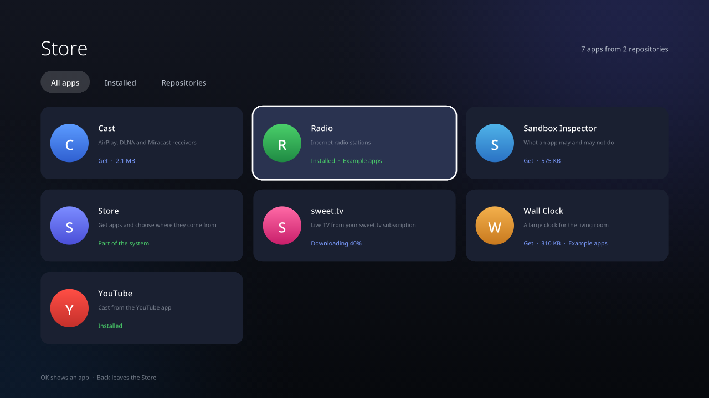
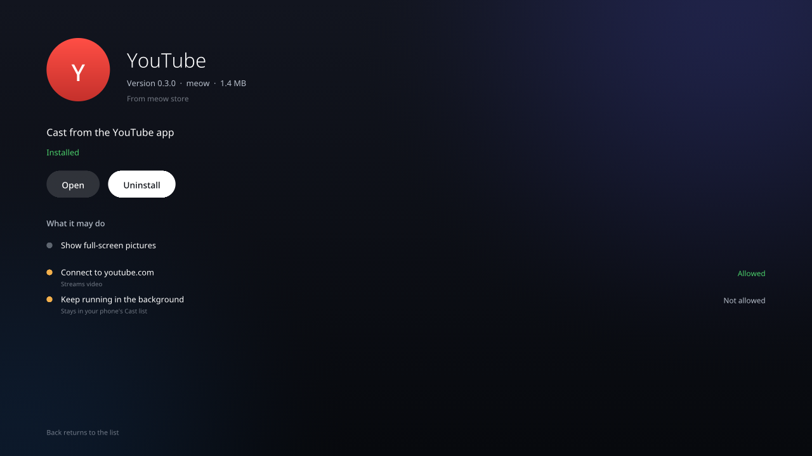
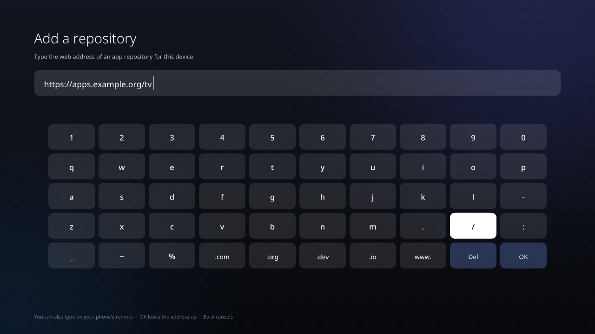

# Store

The device's app store (`dev.meow.store`): the apps of every repository, install, open and
uninstall, and the list of repositories apps come from. How repositories and the
`manage-apps` permission work is in
[../README.md](../README.md#the-store-app-and-repositories); this file is about the app.

| | |
| --- | --- |
|  |  |
|  | |

(Host renderings, `store ui-preview`. What it does on the dongle is in
[../README.md](../README.md#the-store-app-and-repositories).)

## Screens

| Screen | What it does |
| --- | --- |
| All apps, Installed | Cards in three columns, sorted by name: the app's initial on its badge colours, name, summary, and "Get · size", "Installed", "Downloading 40%" or what went wrong. An app of an added repository names it |
| An app's page | Version, publisher, repository, size, everything it asks for with the app's own reasons (sensitive permissions marked, and whether they are allowed once installed). **Install**, or **Open** and **Uninstall** |
| Install question | Only when the app asks for something sensitive: Allow, Don't allow (install without, when the app can do without), Cancel |
| Repositories | The meow store (built in) and the added ones with their state; OK opens a panel with the address, the signing key's fingerprint and Switch off / Remove (the meow store: Check now) |
| Add a repository | An address field with an on-screen keyboard (the phone remote's keyboard types into it too). OK looks the address up; a panel then shows the name, the key's fingerprint and the number of apps, with Cancel focused |

Back leaves a page, and from the lists it leaves the Store.

## Code

| File | What |
| --- | --- |
| [src/model.rs](src/model.rs) | The lists as appd sends them (`STORE repo`, `STORE app` … lines) |
| [src/state.rs](src/state.rs) | Where the user is and what a key does; a key returns the requests to send, so all of it runs in tests |
| [src/ui.rs](src/ui.rs) | Drawing, from the lists and the state into the shared canvas (`meow_media::canvas`) |
| [src/main.rs](src/main.rs) | The loop: events in, requests out, and only the changed part of the picture copied to the UI plane |

```sh
# on the build host (builder container), from apps
cargo test -p store --target "$host"
store ui-preview OUT_DIR ../ui/assets/fonts/latin      # every screen as a PNG
sh test-store.sh                                       # with appd, end to end (see the script)
```

On the device, `appctl key shot` makes the app write what it shows to `/tmp/shot.ppm` at half
size (read it from `/proc/$(pidof store)/root/tmp/shot.ppm`), and `appctl logs dev.meow.store`
has a line for every frame that took more than 200 ms.

`store selftest REQUEST…` is the screenless mode `test-store.sh` packs as a test app: it
prints every line appd sends and makes the requests one after another.
