# Showcase

Screenshots taken from the device (1080p output, scaled down here). The network name,
addresses, pairing code and developer computer in them are made up.

The look follows [Plasma Bigscreen](https://plasma-bigscreen.org/), and the wallpapers are
[KDE Plasma's](https://github.com/KDE/plasma-workspace-wallpapers).

## Home

Rows of cards, moved through with a D-pad: the apps opened last, all installed apps, and
shortcuts into Settings. The top bar has the clock, quick settings, volume, Wi-Fi, the paired
phone and power.

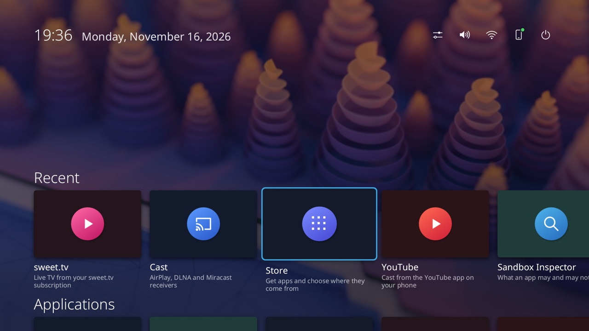

The apps on these screens other than Store and Sandbox Inspector come from
[meowcast/apps-extra](https://github.com/meowcast/apps-extra).

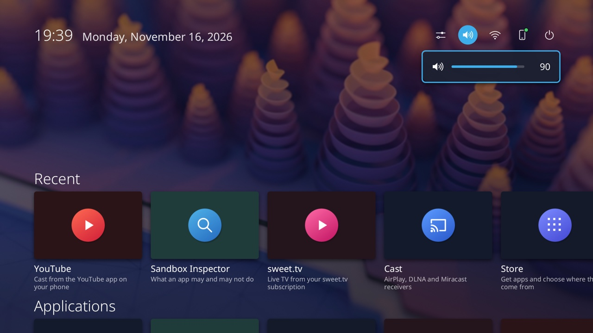

## Pairing a phone

A short press of the button on the dongle, or Settings > Wi-Fi > Pair a phone, shows a QR
code. The phone opens the remote in its browser: no app to install.

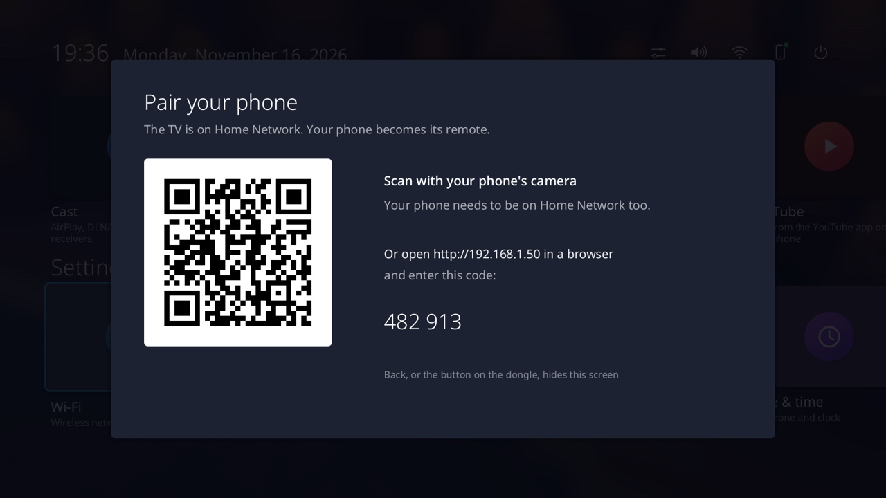

## Settings

| | |
| --- | --- |
| 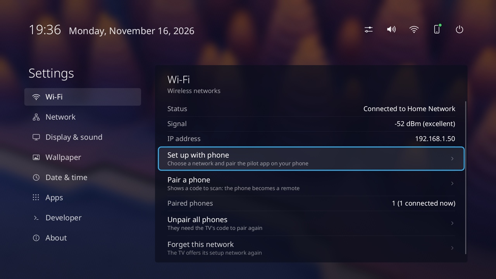 | 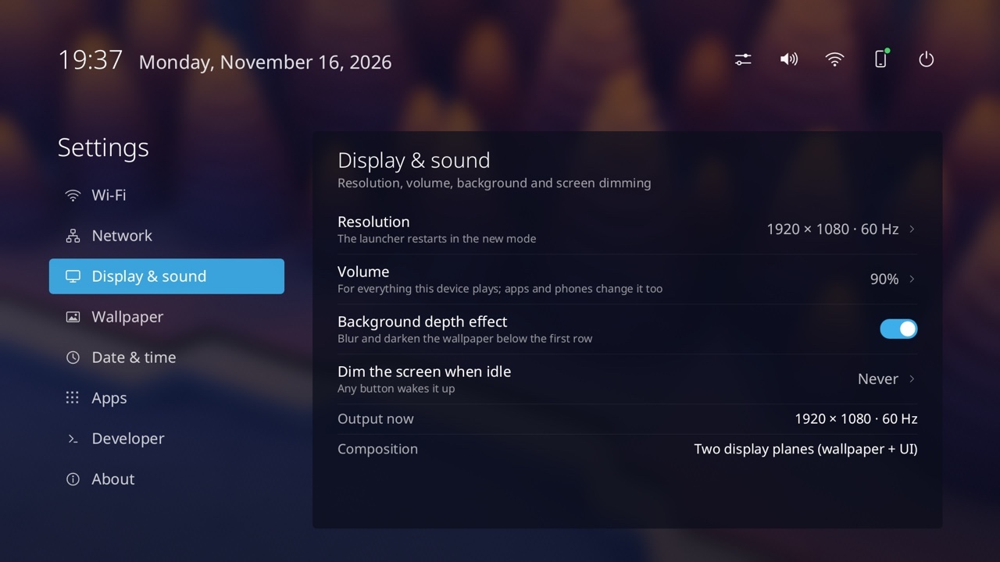 |
| 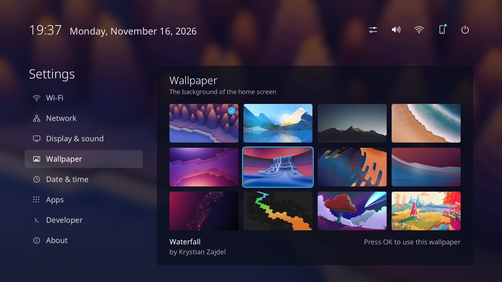 | 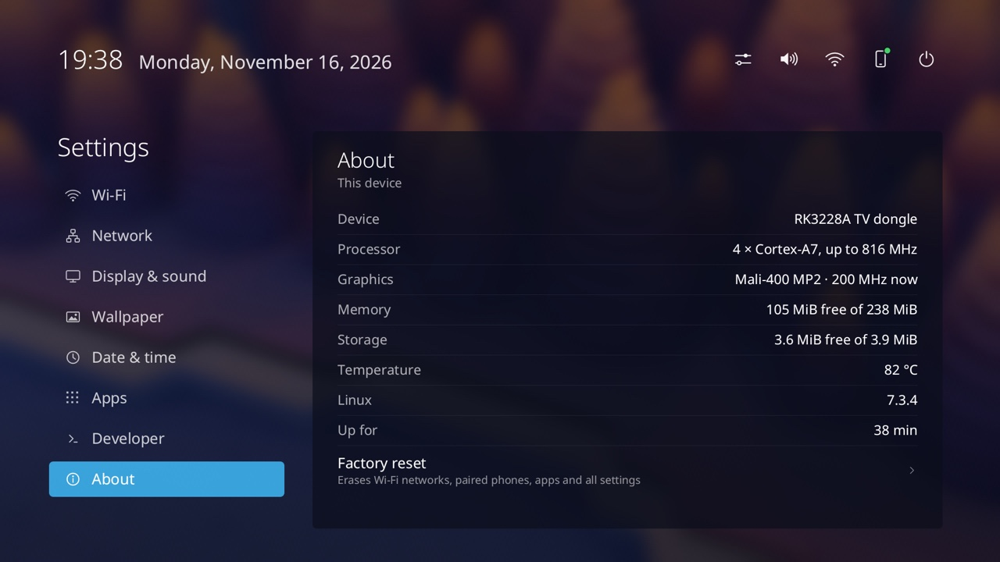 |

## Apps and permissions

Every app runs in its own sandbox and gets only what its permissions say. Settings lists the
installed apps, what each may do, and what runs in the background.

| | |
| --- | --- |
| 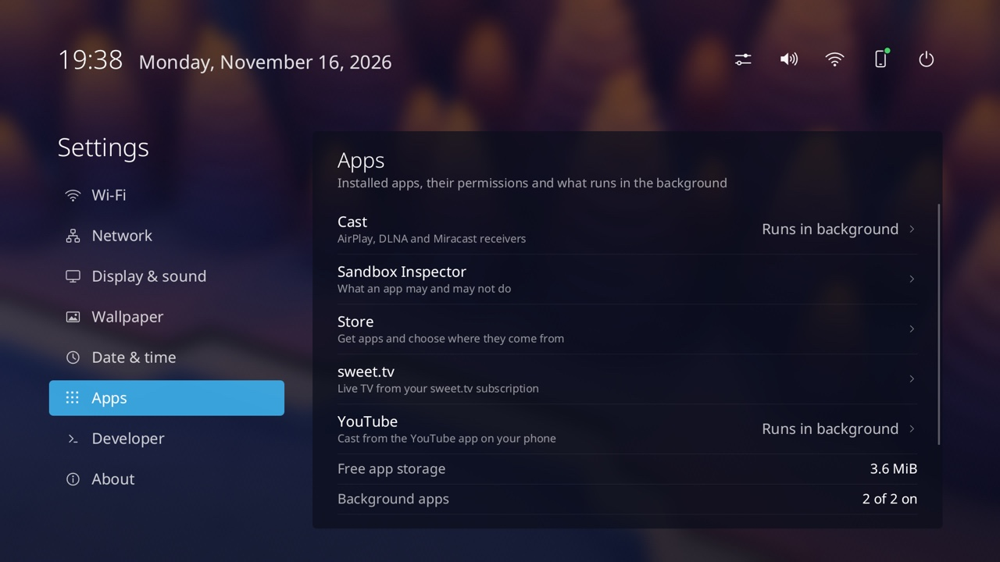 | 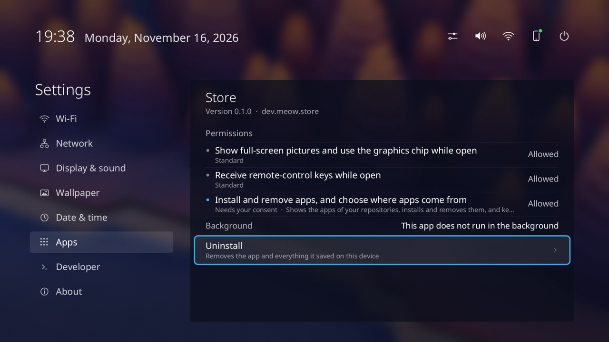 |

## Store

The Store app lists the apps of the built-in store and of every repository you add by
address; a repository's signing key is shown before it is added.

| | |
| --- | --- |
| 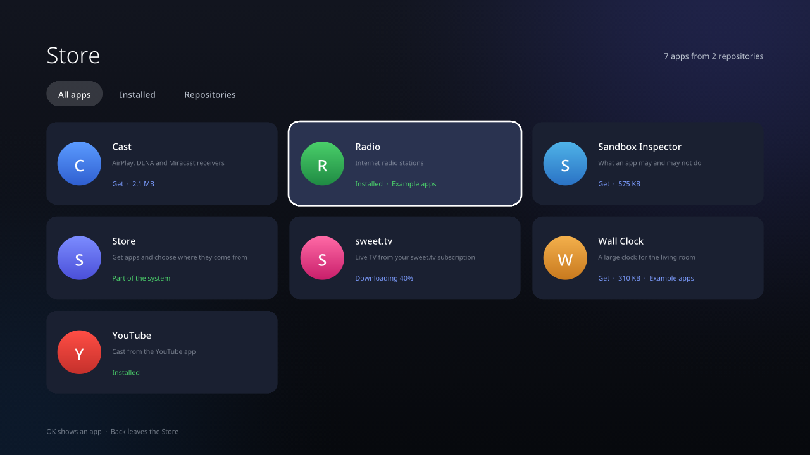 | 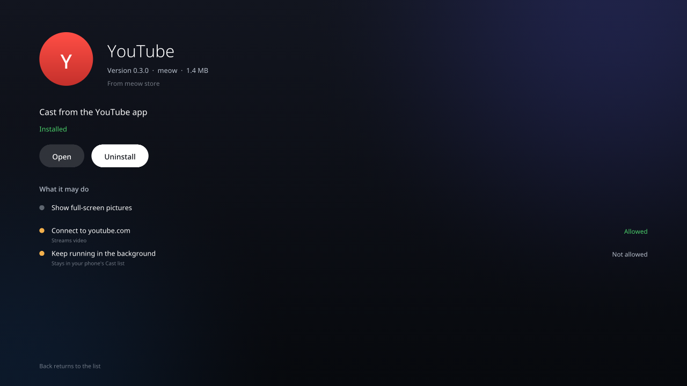 |
| 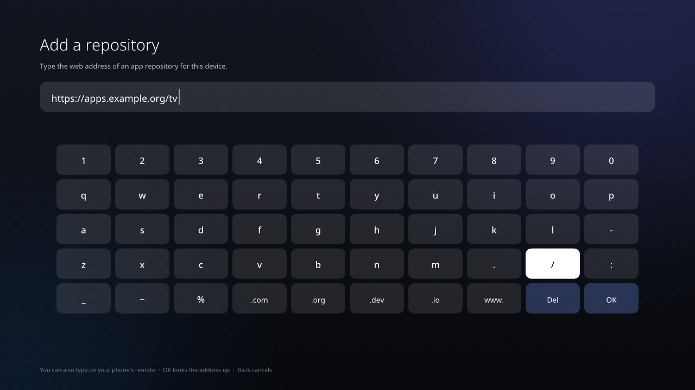 | |

## For developers

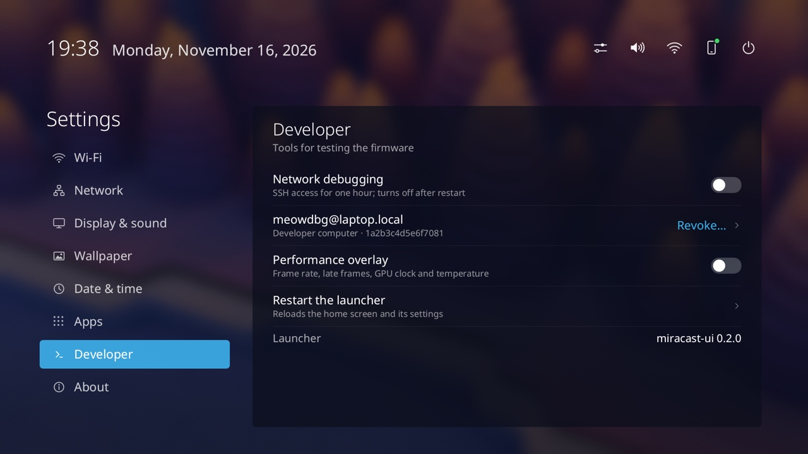
